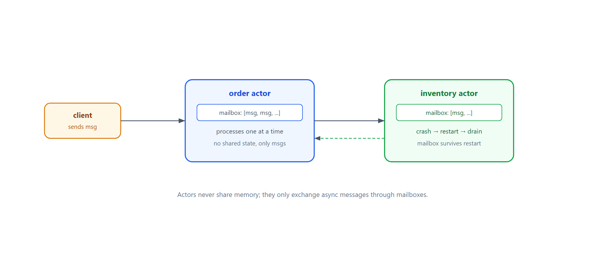
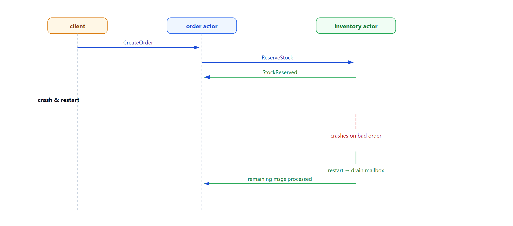

# Learn Actor Model — Messaging, Mailboxes, Crash Recovery

> **Learning / study repo. Self-contained demo, NOT production Akka/Erlang.**
> Everything is an actor. Actors communicate ONLY via async messages, each has a mailbox
> (queue), processes messages one at a time, and can crash and restart without losing queued messages.

## The idea

```
  client ──msg──► order actor ──msg──► inventory actor
                    │                     │
                 mailbox               mailbox
                 (queue)              (queue)
                    │                     │
                 process one at a time; crash → restart → drain mailbox
```

- **No shared memory** — actors never touch each other's state; only messages.
- **Mailbox** — incoming messages queue up; the actor handles them serially.
- **Location transparency** — you send a message to an actor id; local or remote looks the same.
- **Crash isolation & restart** — an actor that crashes restarts; its surviving mailbox keeps
  the messages it had already queued.



## Why this matters

- **Concurrency without locks** — serial mailbox means no shared-state races.
- **Fault tolerance** — failures are isolated per actor; supervision restarts them.
- **Natural for distributed systems** — message-passing maps cleanly to network calls.

## Run

```bash
python run_all.py
```

Pure Python standard library (synchronously delivered, no real threads/network).

## Demo cases

1. **Request-reply** — order actor asks inventory actor to reserve stock; reply returns.
2. **Crash & restart** — inventory crashes on a bad order, restarts, and drains the rest of its mailbox.

## Flow



## Sibling repos

- `learn_raft_consensus` — consensus across replicated nodes.
- `learn_crdt_merge` — concurrent edits that merge without coordination.
- `learn_event_fanout` — events broadcast to independent pipelines.
